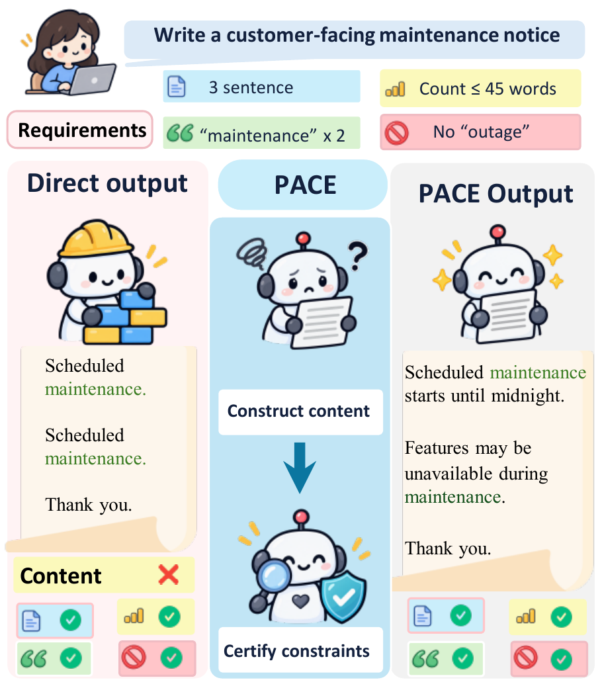
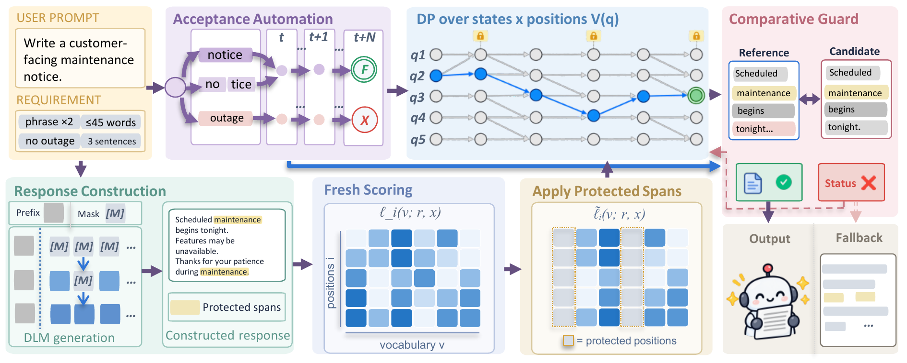

# PACE

**Certified Yet Unfulfilled: Construct-Then-Certify Instruction Following with Diffusion Language Models**

[](https://github.com/xuanhuayin/PACE/actions/workflows/cpu-tests.yml)
[](https://www.python.org/)
[](LICENSE)

PACE is a training-free framework for instruction following with diffusion language models. It constructs task content, recomputes token scores on that answer, jointly enforces compiled acceptance conditions, and checks certification edits against the constructed content.

**Certified is not fulfilled.** A formal pass can still rely on empty structures, repetition, or meaningless insertions. PACE connects content construction to exact inference over the retained finite-state predicates.

<p align="center">
  
</p>

*Figure 1 from the paper: passing checks does not ensure fulfillment.*

## Method Overview



*Figure 2 from the paper: construction, answer-conditioned rescoring, joint certification, and comparative edit guards.*

## Project Structure

```text
src/pace/
  construction/   # Constraint programs that construct answer content
  constraints/    # Base predicates and content-aware acceptance conditions
  automata/       # Finite-state compilation and joint constrained inference
  guards/         # Comparative checks on certification edits
  models/         # TESS-2, LLaDA, LLaDA2, and Dream adapters
  pipelines/      # Native generation, graph compilation, and PACE workflows
  evaluation/     # Official accuracy, content diagnostics, fulfillment audits
  data/           # Public benchmark and tokenizer-resource setup
  services/       # Optional CPU certification worker
configs/          # Held-out evaluation split
assets/           # Pinned third-party verifier snapshots and notices
results/          # Reported results, provenance, and release validation
examples/         # Synthetic audit input
scripts/          # Repository integrity tools
tests/
  unit/           # Exact-inference, evaluation, and CLI tests
  regression/     # Construction and comparative-guard cases
  fixtures/       # Synthetic model and automaton fixtures
docs/             # Architecture, running, and evaluation guides
```

Start with the [architecture guide](docs/architecture.md) for the path from construction to certification. The three method components live in [`construction/`](src/pace/construction/), [`constraints/`](src/pace/constraints/), and [`guards/`](src/pace/guards/). Model-specific code stays in [`models/`](src/pace/models/).

## Installation

Use **Python 3.12**. Some files use syntax introduced in Python 3.12.

```bash
git clone https://github.com/xuanhuayin/PACE.git
cd PACE
python3.12 -m venv .venv
source .venv/bin/activate
python -m pip install --upgrade pip
python -m pip install -e .
pace setup-assets
```

The setup script fetches public benchmark prompts and NLTK resources. It verifies pinned benchmark data and IFEval sentence-tokenizer hashes. Verifier source snapshots and third-party licenses are included in `assets/`.

For GPU inference, choose one environment:

```bash
# TESS-2, LLaDA, LLaDA-1.5, or Dream
python -m pip install -r requirements-gpu.txt

# LLaDA2.0-mini: use a separate environment
python -m pip install -r requirements-llada2.txt
```

The experiments used NVIDIA GeForce RTX 5090 GPUs with PyTorch 2.8.0 and CUDA 12.8. Install a compatible PyTorch build for your CUDA environment. Compilation and certification also use CPU resources. Memory and runtime depend on graph size, answer length, and backbone.

TESS-2 additionally requires its pinned public implementation:

```bash
pace setup-assets --tess
```

Model weights are obtained separately or supplied through `--checkpoint`.

The source checkout is the supported installation layout because benchmark assets and configuration files are stored alongside the package. `python -m pace` is equivalent to `pace`. The top-level `run.py`, `evaluate.py`, and `setup_assets.py` wrappers remain available.

## Quick Start

Run **native → compile → generate → evaluate** in order:

```bash
pace run --model llada --benchmark ifeval --stage native
pace run --model llada --benchmark ifeval --stage compile -- --workers 6
pace run --model llada --benchmark ifeval --stage generate
pace evaluate --model llada --benchmark ifeval --output reports/llada-ifeval.json
```

The default IFEval report uses the **341-prompt holdout with 516 instructions**. Generation and compilation retain the full public prompt order. Development prompts are excluded when held-out results are summarized. Use `--split all` for all 541 prompts.

For IFBench:

```bash
pace run --model tess --benchmark ifbench --stage native
pace run --model tess --benchmark ifbench --stage compile -- --workers 6
pace run --model tess --benchmark ifbench --stage generate
pace evaluate --model tess --benchmark ifbench --output reports/tess-ifbench.json
```

IFBench uses all **300 prompts and 344 instructions**.

### Supported Backbones

| Backbone | `--model` | Default checkpoint / usage |
|---|---|---|
| TESS-2 | `tess` | `hamishivi/tess2` |
| LLaDA | `llada` | `GSAI-ML/LLaDA-8B-Instruct` |
| LLaDA-1.5 | `llada` | Supply its checkpoint through `--checkpoint` |
| LLaDA2.0-mini | `llada2` | `inclusionAI/LLaDA2.0-mini` |
| Dream | `dream` | `Dream-org/Dream-v0-Instruct-7B` |

For LLaDA-1.5, pass the same checkpoint and a separate working directory to every stage:

```bash
pace run --model llada --checkpoint checkpoints/llada-1.5 --work-dir outputs-llada15 --stage native
pace run --model llada --checkpoint checkpoints/llada-1.5 --work-dir outputs-llada15 --stage compile
pace run --model llada --checkpoint checkpoints/llada-1.5 --work-dir outputs-llada15 --stage generate
pace evaluate --model llada --work-dir outputs-llada15 --output reports/llada15-ifeval.json
```

Replace the example checkpoint path with a real model directory or public Hugging Face identifier. For the original TESS-2 snapshot, obtain revision `684af5623534d9163509df1d37b77412b0737671` and pass the local snapshot through `--checkpoint`.

Additional stage arguments follow `--`. Use `pace run --model llada --stage compile -- --help` to inspect stage options, or add `--dry-run` before `--` to print the command without executing it. See [running details](docs/running.md) for outputs and fallback behavior.

## Evaluation

Official acceptance and substantive fulfillment are separate quantities:

* `pace evaluate` reports strict/loose prompt and instruction accuracy, exact counts, missing records, and empty answers. Missing responses remain in the denominator. An explicitly empty PACE answer remains a failure.
* `pace.evaluation.content` and `pace.evaluation.ifbench_content` report supported content predicates and detector diagnostics.
* Audit-estimated fulfillment multiplies official instruction accuracy by the mean of two binary Genuine judgments among sampled official passes. This requires actual audit labels.

```bash
pace evaluate --model llada --benchmark ifeval --method native

# Synthetic audit schema example, not experimental results
pace audit examples/audit_fixture.json --output reports/audit-example.json
```

See [evaluation and auditing](docs/evaluation.md) for the audit schema and confidence intervals. Private audit labels, participant identities, weights, and experiment logs are not distributed.

## Reported Results

Audit-estimated fulfillment, in percent, from the reference manuscript:

| Backbone | IFEval Native | IFEval PACE | IFBench Native | IFBench PACE |
|---|---:|---:|---:|---:|
| TESS-2 | 23.1 | **55.0** | 6.1 | **31.5** |
| LLaDA | 55.3 | **73.4** | 9.3 | **24.1** |
| LLaDA-1.5 | 58.3 | **71.3** | 12.9 | **30.5** |
| LLaDA2.0-mini | 67.6 | **81.6** | 22.4 | **37.2** |
| Dream | 52.1 | **68.6** | 11.4 | **28.2** |

The [machine-readable table](results/paper_results.csv) includes matched controls, official accuracy, Genuine shares, and fulfillment intervals. Values are rounded manuscript results with [source provenance](results/provenance.json), not new release runs. Comparisons use the same backbone. PACE does not exceed direct certification in every backbone/benchmark combination, as the LLaDA-1.5 IFEval rows show.

## Tests

After CPU installation and asset setup:

```bash
python scripts/check_integrity.py
python -m unittest discover -s tests/unit -t . -v
python -m tests.regression.ifeval
python -m tests.regression.ifbench
```

Solver tests compare inference against exhaustive finite-path enumeration. Construction and guard tests use synthetic fixtures without weights. Release-tool tests cover denominator preservation, empty answers, duplicate keys, shared audit draws, and ranking reversals. GitHub Actions runs the CPU suite. GPU inference is outside this CI job.

## Reproducibility and Scope

Included: PACE inference, all five backbone interfaces, both benchmark evaluators, CPU tests, and audit aggregation. Training is not required. Published baseline repositories and private annotation infrastructure are not bundled. See [reproducibility](docs/reproducibility.md) for exact boundaries.

## License and Attribution

Original PACE code is provided under the [Apache License 2.0](LICENSE). Third-party files retain their upstream notices. Benchmark data and model checkpoints remain subject to upstream terms. See [third-party notices](THIRD_PARTY_NOTICES.md).

## Citation

```bibtex
@misc{yin2026pace,
  title  = {Certified Yet Unfulfilled: Construct-Then-Certify Instruction Following with Diffusion Language Models},
  author = {Yin, Xuanhua and Wei, Boyu and Mao, Shunqi and Xu, Chuanzhi and Cai, Weidong},
  year   = {2026},
  url    = {https://github.com/xuanhuayin/PACE}
}
```

[CITATION.cff](CITATION.cff) also supports GitHub's citation interface.
